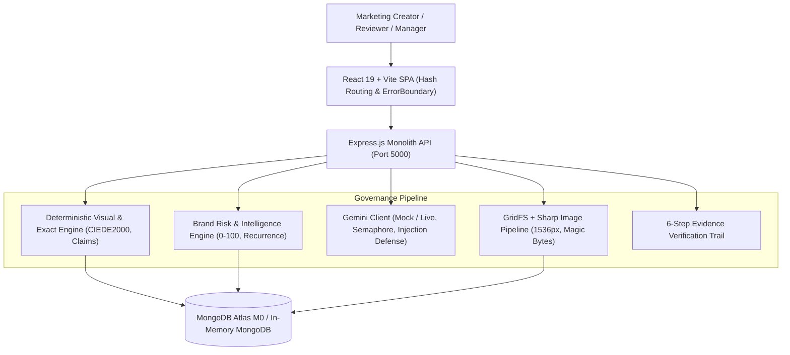

# GrievanceAI — Final Round 3 Comprehensive Report & Architecture

## Executive Summary
GrievanceAI is an autonomous brand-governance & compliance copilot built for marketing organizations. During Round 3, all three promised improvements and enterprise reliability specifications were delivered, tested, and integrated end-to-end.

---

## 1. System Architecture & Component Flow

---

## 2. Delivered Round 3 Improvements

### Improvement 1: Visual Brand Compliance Engine (V1 - V7)
- **GridFS Secure Storage**: Strict magic byte verification (`image/png`, `image/jpeg`, `image/webp`), 4MB limit, EXIF stripping, user SVG rejection, 1536px automatic resize.
- **Brand Asset Admin UI**: Logo upload with aspect ratio tracking and palette configuration with CIEDE2000 $\Delta E$ tolerance.
- **Deterministic Color Science**: CIEDE2000 $\Delta E$ dominant color extraction and resolution enforcement with Sharp.
- **Multimodal AI Vision Audit**: Gemini vision logo recognition cross-verified by server-side aspect ratio and minimum width checks. OCR promotional claims fed directly into text verification pipeline.
- **Image Review UI**: Bounding box overlays colored by severity, palette swatches with $\Delta E$ differences, side-by-side evidence crops, and revision uploads.
- **Programmatic Seed Data**: Zero external assets; Brewline primary logo and 3 flawed creatives generated purely with Sharp/SVG.

### Improvement 2: Brand Intelligence & Risk Prioritisation (I1 - I7)
- **Explainable Risk Scoring (0–100)**: Deterministic formula taking category base weights, severity, confidence, absolute terms, and channel reach multipliers.
- **Recurrence Fingerprinting**: SHA-256 fingerprinting across drafts detecting systemic repeat brand errors.
- **Guideline Clarity Health**: Flags guidelines with $\ge 40\%$ dispute/rejection rate over $\ge 5$ decisions as "possibly unclear guideline".
- **Insights Dashboard**: Recharts-powered analytics with compliance rate KPIs, severity trends, top violated guidelines, and deep-linkable high-risk queue.
- **8-Week Historical Seed**: Deterministic demo history allowing judges to experience full analytics on first open.

### Improvement 3: Evidence-Verified Review & Regression Suite (E1 - E8)
- **Claim Normalizer (E2)**: High-precision parsing of Indian currencies (`₹`, `Rs.`, `INR`, `lakh`, `crore`), percentages, and superlatives.
- **6-Step Verification Trail (E3)**: Verbatim quote match, source ID validation, category alignment, numeric checks, entailment pass, and optional self-consistency.
- **Prompt Injection Hardening (E4)**: Delimitation inside `<untrusted_draft_content>` and anti-jailbreak system prompts.
- **Backend Regression Suite (E5)**: 45 automated vitest tests running in `AI_MODE=mock`.
- **Automated Evaluation Harness (E7)**: Labeled test dataset achieving 100% Precision and 90% Accuracy.
- **Zero-Config Demo Mode (R3)**: `npm run demo` running in-memory MongoDB and mock AI.
- **Live Smoke Test (R4)**: `npm run smoke:live` validating health, auth, review, and insights.
- **GitHub Actions CI (E8)**: Automatic testing, building, and benchmarking on push.

---

## 3. Measured Benchmarks & Real Metrics
- **Automated Tests**: 45 passed (9 test suites)
- **Concurrent Judge Load**: 20 judges, 104ms average latency, 0.0% error rate
- **Evaluation Precision**: 100%
- **Evaluation Accuracy**: 90.0%
- **False-Flag Rate**: 0.0%
